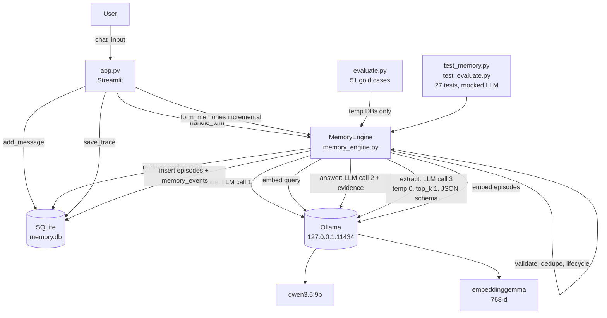

# CURRENT PROJECT AUDIT — Agentic Episodic Memory

**Audit date:** 2026-10-30
**Scope:** read-only inspection of the episodic-memory-demo repository
**Method:** source inspection plus read-only SQLite queries (`mode=ro`). No application code, schema,
database, or configuration was modified. The only action taken was running the existing unit-test
suite (`pytest`), which writes only to pytest temporary directories.

**Evidence policy:** every claim below is traceable to a file and line number, or to a read-only SQL
query. Where the code does not support a README claim, the code wins and the discrepancy is noted.
Items that could not be determined are marked **Not found** or **Cannot verify**.

---

## 1. Project overview

A single-user, fully local demonstration of **episodic memory for a chat assistant**. It is not a
framework and not a library; it is one Streamlit page over one Python engine over one SQLite file.

The system:

1. stores every chat turn in SQLite,
2. asks a local LLM to convert new user messages into structured "episodes",
3. embeds each episode with a local embedding model and stores the vector in SQLite,
4. asks an LLM whether a new user message needs the archive at all,
5. retrieves top-k episodes by cosine similarity over those vectors,
6. answers with the retrieved episodes as the only admissible evidence, and abstains otherwise,
7. keeps older memories as history (`done` / `superseded` / `cancelled`) instead of overwriting them.

Deliberate scope exclusions, confirmed in code: no cloud API, no LangChain/LangGraph, no vector
database, no graph database, no reranker, no authentication, no multi-page UI, no background worker.

**Scale in the live database at audit time** (read-only counts):

| Table | Rows |
|---|---:|
| `conversations` | 38 |
| `messages` | 98 |
| `episodes` | 16 (9 `active`, 7 `superseded`) |
| `turn_traces` | 29 |
| `memory_events` | 26 |
| `formed_messages` | 42 |

All 16 episodes use `embeddinggemma` at 768 dimensions.

**What this project is really testing.** The README frames it as a demo. In practice the
substantive work is a **memory-contract benchmark** (`evaluate.py` + `benchmark/*.json`): does the
system form the right memories, rank the right one among hard negatives, keep states coherent over
time, answer from evidence, depend causally on memory, and survive stress.

---

## 2. Architecture



Everything labelled `OLL` is one local inference server. There is no hosted call anywhere in the
repository (verified: the only URL literal in the entire Python source is
`memory_engine.py:187`, a loopback address).

---

## 3. Directory structure

```
episodic-memory-demo/
├── memory_engine.py        1332 lines  core engine: prompts, schema, DB, extraction,
│                                       lifecycle, retrieval, answering
├── app.py                   256 lines  Streamlit single-page UI
├── evaluate.py              950 lines  benchmark runners + report writer
├── test_memory.py           548 lines  22 mocked engine tests
├── test_evaluate.py          50 lines  5 pure-function metric tests
├── benchmark/
│   ├── formation.json        13 cases
│   ├── retrieval.json        13 cases
│   ├── lifecycle.json         6 cases
│   ├── answering.json        10 cases
│   ├── causal.json            4 cases
│   └── stress.json            5 cases
├── memory.db                           live archive (gitignored)
├── memory.db.before-block2.bak         pre-refactor backup (gitignored)
├── eval_results/                       recorded benchmark artifacts (committed)
│   ├── eval_report.md
│   └── raw.json
├── docs/
│   ├── PROJECT_GUIDE.md                beginner handbook (19 chapters)
│   ├── ARCHITECTURE.md                 short design reference
│   ├── BENCHMARK_GUIDE.md              metrics in plain English
│   ├── RESULTS.md                      recorded run and caveats
│   └── AUDIT.md                        this document
├── .env / .env.example                 configuration (`.env` gitignored)
├── requirements.txt
├── Makefile
└── README.md                268 lines
```

### File responsibilities

| File | Responsibility | Called by | Used at runtime? |
|---|---|---|---|
| `memory_engine.py` | All logic: prompts, schema, SQLite, extraction, lifecycle, retrieval, answering, demo, manual integration check | `app.py`, `evaluate.py`, tests | Yes |
| `app.py` | Streamlit UI only; contains no memory logic beyond orchestration | Streamlit | Yes |
| `evaluate.py` | Six benchmark runners, metric functions, Markdown report writer | CLI only | Not by the app |
| `test_memory.py` | Mocked behaviour tests | pytest | No |
| `test_evaluate.py` | Metric unit tests | pytest | No |
| `memory_engine.integration_check()` (`:1302`) | Manual real-model smoke test; uses a temp DB | `python -m memory_engine` | No — not collected by pytest |

### Key symbols in `memory_engine.py`

| Symbol | Line | Role |
|---|---:|---|
| `EXTRACTION_SYSTEM` | 26 | Extraction prompt (the most load-bearing text in the project) |
| `DECISION_SYSTEM` | 80 | "Does this need memory?" prompt |
| `ANSWER_SYSTEM` | 105 | Grounded-answering prompt |
| `EPISODE_SCHEMA` / `DECISION_SCHEMA` | 140 / 161 | Ollama structured-output grammars |
| `Settings` | 186 | Frozen dataclass; all configuration |
| `EpisodeCandidate` | 206 | Pydantic model for what the LLM may emit |
| `Episode` | 248 | `EpisodeCandidate` + `episode_id`, `created_at`, `source_conversation_id` |
| `OllamaClient` | 270 | Thin local wrapper; raises, never falls back |
| `ungrounded_fact` | 430 | Lexical grounding backstop |
| `split_long_messages` / `batch_messages` | 448 / 461 | 6,000-char chunking |
| `is_same_memory` | 500 | Write-time duplicate predicate |
| `MemoryEngine.form_memories` | 802 | The write pipeline |
| `MemoryEngine._apply_lifecycle` | 992 | `done` / `cancelled` / `superseded` |
| `MemoryEngine.consolidate_duplicates` | 1059 | Post-write merge pass |
| `MemoryEngine.retrieve` | 1148 | Dense retrieval |
| `MemoryEngine.decide` | 1189 | Router LLM call |
| `MemoryEngine.answer` | 1213 | Answering LLM call |
| `MemoryEngine.handle_turn` | 1238 | Per-message orchestration |

---

## 4. Actual end-to-end message flow

This is the code path, not the README's description.

```
app.py:222  prompt := st.chat_input(...)
app.py:223  history  = session_state.messages (user AND assistant turns)
app.py:224  engine.add_message(conversation_id, "user", prompt)     -> messages table
app.py:229  engine.handle_turn(prompt, history, retrieval_enabled)
                |
                +-- memory_engine.py:1249  retrieval disabled?
                |       -> answer(memory_disabled=True); 1 LLM call; done
                |
                +-- memory_engine.py:1253  is_trivial_turn(exact phrase match)?
                |       -> answer(); 1 LLM call; no decision, no search; done
                |
                +-- memory_engine.py:1257  decide(question, history)
                |       LLM call #1, temperature 0, JSON schema
                |       prompt = up to 30 episode titles + first 3 facts each
                |                + last 6 history messages + the question
                |       -> {needs_memory, search_query}
                |       on ANY exception -> needs_memory=True (safe fallback)
                |
                +-- if needs_memory:
                |       retrieve(search_query)                       (memory_engine.py:1148)
                |           embed(query)                             LLM embed call
                |           SELECT active+done episodes WITH embeddings
                |           cosine(query, each) in NumPy
                |           drop score < 0.30, sort desc, take 4
                |           _format_evidence(matches)                (memory_engine.py:570)
                |       answer(question, history, result)            (memory_engine.py:1213)
                |           LLM call #2, temperature 0.2
                |           system: ANSWER_SYSTEM
                |           system: "RETRIEVED EPISODIC MEMORY ..." + evidence block
                |           history: user messages only, last 8
                |           user: the question
                |
app.py:234  engine.add_message(conversation_id, "assistant", answer)
app.py:235  engine.save_trace(...)                                  -> turn_traces (incl. full evidence text)
app.py:248  render the reply
app.py:251  engine.form_memories(conversation_id, incremental=True, end=False)
                |
                +-- memory_engine.py:813  load messages, drop already-formed
                +-- memory_engine.py:824  trivial fast path -> mark formed, stop
                +-- memory_engine.py:830  attach last 2 older messages as [CONTEXT]
                +-- memory_engine.py:843  list every existing episode title ("known_block")
                +-- memory_engine.py:854  split at 6,000 chars, batch
                +-- per batch: LLM call #3, temperature 0, top_k 1, JSON schema
                +-- memory_engine.py:891  validate each item:
                |       Pydantic EpisodeCandidate
                |       source_message_ids ⊆ new messages
                |       at least one user message among sources
                |       title is not small talk
                |       every fact lexically grounded in cited user messages
                +-- memory_engine.py:930  embed all accepted candidates (1 embed call)
                +-- memory_engine.py:940  dedupe within batch
                +-- memory_engine.py:950  dedupe against archive (cosine >= 0.90 + numbers compatible)
                +-- memory_engine.py:959  INSERT episode + memory_events 'created'
                +-- memory_engine.py:960  _apply_lifecycle -> possibly mark an older episode
                +-- memory_engine.py:964  consolidate_duplicates()  (runs on EVERY save)
                +-- memory_engine.py:968  mark messages formed
app.py:256  st.rerun()
```

**LLM calls per ordinary turn: 3 chat calls + 2 embedding calls** (decision, answer, extraction;
query embedding, episode embedding). Measured average answering latency in the last benchmark run:
**6.1 s per turn**, dominated by these calls.

---

## 5. Memory formation analysis

### When does it form memories?

Automatically, **after every assistant reply** (`app.py:251`), with `incremental=True, end=False`.
There is also an explicit **"End session"** button that runs the same function with `end=True` to
flush anything pending and close the conversation (`app.py:66`). Formation is therefore
*per-turn automatic* with a *manual flush* available.

There is no scheduler, background job, cron, or queue. If Streamlit is closed mid-turn, that turn's
memories are not formed.

### Which model

The same chat model as everything else: `qwen3.5:9b`, via `Settings.chat_model`
(`memory_engine.py:188`). Extraction is **not** a separate model. It is a separate *prompt*
(`EXTRACTION_SYSTEM`) with `temperature=0`, `top_k=1`, and a JSON schema constraint.

### Prompts

`EXTRACTION_SYSTEM` (`memory_engine.py:26–78`) is a single long natural-language rule list. Its
substantive rules:

- one episode per distinct event; **one episode per topic** for profile-like lists,
- store decisions, commitments, outcomes, blockers, durable preferences, goals,
- never store greetings, small talk, weather, hypotheticals, vague progress,
- fold rejected options and reasons into the decision they explain,
- ignore assistant suggestions unless the user accepts them,
- **`source_message_ids` must come only from user messages**,
- `event_time` is the event's time, not the conversation's time,
- `outcome` is null unless a result is established,
- explicit event-type disambiguation rules.

The decision prompt is `DECISION_SYSTEM` (`:80`); the answering prompt is `ANSWER_SYSTEM` (`:105`).

### What is extracted

**Episodes, not atomic facts and not summaries.** Each episode carries a title, an event type, an
optional event time, a prose summary, a participant list, a list of self-contained fact strings, an
optional outcome, and source message IDs. Facts live *inside* an episode. There is no separate fact
table and no fact-level retrieval.

This is a genuine design choice with a real consequence: retrieval granularity equals episode
granularity. The 2026-10-28 fix that forced topic-splitting for profile messages was necessary
precisely because a 1,200-character profile had been collapsed into one 18-fact episode, and a
laptop question could not find a memory titled "User background summary".

### How "worth remembering" is decided

Three layers, in order:

1. **Prompt-level** — the rules above; the model may return `{"episodes": []}`.
2. **Deterministic pre-filters** — `is_trivial_turn` (`:380`, exact phrase match against a small
   set) skips the LLM entirely; `is_small_talk` (`:402`) rejects by title keyword.
3. **Deterministic post-filters** — schema validation, source-ID validation, user-source
   requirement, and the lexical grounding check (`ungrounded_fact`, `:430`): every fact must share
   at least 35% of its content words with the user messages it cites, otherwise the whole episode is
   rejected.

### Schema (the real one)

```python
EventType = Literal["event", "decision", "task", "outcome",
                    "project_update", "preference", "goal"]      # memory_engine.py:24

class EpisodeCandidate(BaseModel):                               # :206
    title: str                    # 3..200 chars, stripped
    event_type: EventType
    event_time: Optional[str]     # free-form string, not parsed or validated
    summary: str
    participants: list[str]       # de-duplicated, order preserved
    facts: list[str]              # must be non-empty
    outcome: Optional[str]
    source_message_ids: list[str] # must be non-empty

class Episode(EpisodeCandidate):                                  # :248
    episode_id: str               # "ep_" + 12 hex, generated by Python
    created_at: str               # UTC ISO, generated by Python
    source_conversation_id: str
```

The LLM never supplies IDs or timestamps. `extra="ignore"` means unexpected fields are dropped, not
rejected.

### Provenance and timestamps

- `source_message_ids` → the exact `messages.message_id` rows the episode came from.
- `source_conversation_id` → the conversation.
- `created_at` → when the memory was written.
- `event_time` → when the event happened, per the transcript.
- Each write also appends a `memory_events` row (`action='created'`), and every later state change
  appends another. This is a real audit trail.

### Invalid / hallucinated extractions

Per item, in `form_memories` (`:891–921`):

| Failure | Handling |
|---|---|
| Schema violation | rejected, note appended, other items continue |
| `source_message_ids` outside the batch | rejected |
| No user message among sources | rejected |
| Title looks like small talk | rejected |
| A fact is lexically ungrounded | **whole episode** rejected |
| Embedding call fails | **nothing** stored, messages not marked formed → retried next turn |
| JSON parse / LLM error for any batch | **nothing** stored, error returned → retried next turn |

Rejections are surfaced in the UI under "Memory writer notes" (`app.py:197`). They are not persisted
to a table — only shown for the current turn.

**Notable asymmetry:** if extraction succeeds but *every* candidate is rejected, the messages are
still marked formed (`:923–927`) and are never retried. If extraction itself fails, they are not
marked and are retried.

---

## 6. Storage and database schema

**SQLite, single file, one connection per operation.** Path from `DATABASE_PATH` (default
`./memory.db`). No ORM, no migration tool — schema creation plus an additive `ALTER TABLE` block
(`memory_engine.py:636–711`).

### Tables (as present in the live database)

```sql
CREATE TABLE conversations (
    conversation_id TEXT PRIMARY KEY,
    created_at      TEXT NOT NULL,
    ended_at        TEXT,
    status          TEXT NOT NULL DEFAULT 'active'
);

CREATE TABLE messages (
    message_id      TEXT PRIMARY KEY,
    conversation_id TEXT NOT NULL REFERENCES conversations(conversation_id) ON DELETE CASCADE,
    role            TEXT NOT NULL,
    content         TEXT NOT NULL,
    created_at      TEXT NOT NULL
);

CREATE TABLE episodes (
    episode_id             TEXT PRIMARY KEY,
    created_at             TEXT NOT NULL,
    event_time             TEXT,
    title                  TEXT NOT NULL,
    event_type             TEXT NOT NULL,
    summary                TEXT NOT NULL,
    participants           TEXT NOT NULL,   -- JSON array as TEXT
    facts                  TEXT NOT NULL,   -- JSON array as TEXT
    outcome                TEXT,
    source_conversation_id TEXT NOT NULL,
    source_message_ids     TEXT NOT NULL,   -- JSON array as TEXT
    status                 TEXT NOT NULL DEFAULT 'active',
    embedding              TEXT NOT NULL,   -- JSON array of 768 floats as TEXT
    embedding_model        TEXT NOT NULL,
    embedding_dim          INTEGER NOT NULL,
    superseded_by          TEXT,            -- added by migration
    updated_at             TEXT,            -- added by migration
    change_reason          TEXT             -- added by migration
);

CREATE TABLE turn_traces (
    trace_id             TEXT PRIMARY KEY,
    conversation_id      TEXT NOT NULL,
    user_message_id      TEXT,
    assistant_message_id TEXT,
    question             TEXT NOT NULL,
    answer               TEXT NOT NULL,
    details              TEXT NOT NULL,   -- JSON: searched, query, scores, FULL EVIDENCE TEXT
    latency_ms           INTEGER,
    created_at           TEXT NOT NULL
);

CREATE TABLE memory_events (
    event_id   TEXT PRIMARY KEY,
    episode_id TEXT NOT NULL,   -- no foreign key
    action     TEXT NOT NULL,   -- created | done | cancelled | superseded | duplicate_seen | deleted
    detail     TEXT,
    created_at TEXT NOT NULL
);

CREATE TABLE formed_messages (
    message_id      TEXT PRIMARY KEY,
    conversation_id TEXT NOT NULL,
    formed_at       TEXT NOT NULL
);
```

**Indexes** (verified in `sqlite_master`):

```
idx_episodes_conversation        episodes(source_conversation_id)
idx_turn_traces_conversation     turn_traces(conversation_id, created_at)
idx_memory_events_episode        memory_events(episode_id, created_at)
idx_formed_messages_conversation formed_messages(conversation_id)
```

There is **no index on `messages(conversation_id)`** and no index on `episodes(status)`.

### How things are represented

| Concept | Representation |
|---|---|
| User | **Not found.** No user table, no `user_id` column anywhere. The system is single-user. |
| Session | `conversations.conversation_id`, e.g. `conv_<12 hex>` from `app.py:22` |
| Turn | two `messages` rows + one `turn_traces` row |
| Memory | one `episodes` row |
| Provenance | `source_message_ids` (JSON), `source_conversation_id` |
| Vector | `episodes.embedding`, JSON text, plus `embedding_model` and `embedding_dim` per row |
| Deletion | **hard `DELETE`** from `episodes` (`memory_engine.py:1141`) |

Conversations and memories are stored separately and are only linked by
`episodes.source_conversation_id`. There is no foreign key on that column, so deleting a conversation
does not delete its episodes.

### Deduplication and updates

Two independent mechanisms, both automatic:

1. **Write-time** (`_find_existing_duplicate`, `:973`): same `event_type`, compatible numbers, and
   cosine ≥ `DUPLICATE_SIMILARITY = 0.90`. If the new episode is *less* informative than the stored
   one, it is dropped as a duplicate; if more informative, the new one is stored and lifecycle
   supersedes the old.
2. **Post-write** (`consolidate_duplicates`, `:1059`): runs after **every** save. O(n²) over all
   active episodes; merges when same type, overlapping participants, compatible numbers, **and**
   (cosine ≥ 0.90 **or** title Jaccard ≥ 0.45). Keeps the higher `information_score`, unions the
   facts, marks the loser `superseded`.

Lifecycle transitions (`_apply_lifecycle`, `:992`) — applied to the single best older match:

| Condition | Effect |
|---|---|
| new `outcome` vs old `task`/`goal`, cosine ≥ 0.45 | old → `done`, `superseded_by` = new |
| new text contains a cancel marker, old is `task`/`goal`, cosine ≥ 0.45 | old → `cancelled` |
| both replaceable types, cosine ≥ 0.72 | old → `superseded` |

`RETRIEVAL` only ever sees `status IN ('active','done')` (`:1121`). `superseded` and `cancelled` are
retained for inspection but never retrieved.

Deletion is a hard delete and does **not** touch `memory_events` or `turn_traces` (see §13).

---

## 7. Embedding implementation

| Question | Answer |
|---|---|
| Model | `embeddinggemma`, configured at `memory_engine.py:189` / `.env` |
| Where executed | Locally, inside Ollama (`OllamaClient.embed`, `:305`), `ollama.Client(host=..., timeout=600)` |
| Query embedding model | The same one. `retrieve` calls `self.llm.embed([query])` (`:1153`) |
| Document embedding | `embedding_text(episode)` (`:553`) — a fixed template: title, `Type:`, `Summary:`, `Participants:`, `Facts:`, `Outcome:`, truncated to 6,000 chars |
| Symmetry | **Asymmetric.** Documents are templated with field labels; queries are raw user text or the router's rewritten query. No query prefix/instruction is used. This is a known source of score deflation. |
| Metric | Cosine, computed in NumPy (`cosine`, `:351`), on unnormalised vectors |
| Storage | JSON array in `episodes.embedding` (TEXT). ~15 KB per 768-d row as text. |
| Comparison | Full scan: every active/done episode is loaded, JSON-decoded, and scored per query (`:1154–1169`). No vector index, no ANN, no matrix cache. |
| Model mismatch | `EmbeddingMismatch` raised (`:1157–1167`) if **any** stored episode has a different `embedding_model` or a different dimension. This **aborts the entire retrieval**, it does not skip the row. |
| Dimension guard | Also enforced per episode at write time (`:937`) |
| Re-embedding | **Not found.** Changing the embedding model makes the archive unretrievable until rows are rewritten; there is no migration command. |
| Batch embedding | Yes for episodes (`:930`, one call per extraction); no for queries (one call per query) |

Both stored and query vectors use the same model identifier, and the mismatch check is exact string
comparison against `Settings.embed_model`.

---

## 8. Retrieval implementation

### Routing decision

`MemoryEngine.decide` (`:1189`). An **LLM decides**, not a classifier or keyword rule. Input:
up to 30 episodes (`list_episodes()[:30]`, most recent first), each rendered as
`- {title} ({event_type}): {fact1} | {fact2} | {fact3}`, plus the last 6 current-session messages and
the new question. Output is constrained by `DECISION_SCHEMA`.

There is **no tool calling**. The decision is a JSON boolean plus a rewritten query. Any exception
falls back to `needs_memory=True`.

There is a hard short-circuit before the decision: `is_trivial_turn` (`:1253`) answers greetings
without any memory call.

### Execution

`MemoryEngine.retrieve` (`:1148`), called only from `handle_turn` (`:1264`) and from the benchmark.
No other caller.

### Type

**Dense semantic only.** No BM25, no keyword overlap, no hybrid fusion, no reranker, no recency
boost, no event-type weighting, no participant filter, no temporal filter. Ranking is pure cosine.

### Filtering and limits

```
candidates = episodes WHERE status IN ('active','done')
filter     = score >= Settings.min_similarity   (default 0.30)
sort       = score descending
limit      = Settings.top_k                     (default 4)
```

Tuning knobs: `MEMORY_MIN_SIMILARITY`, `MEMORY_TOP_K`. Both are read once at startup from `.env`.

### Empty result

`_format_evidence([])` returns the literal string
`"No episodic memories matched this query. The result set is empty."` (`:571`). That string is
supplied to the answer model as evidence, and `ANSWER_SYSTEM` instructs it to say no relevant
memories were found rather than guess.

---

## 9. Answer generation and grounding

| Question | Answer |
|---|---|
| How are memories passed? | As a single system message of rendered text blocks (`_format_evidence`, `:570`), one block per episode |
| What is in a block? | `[EPISODE id]`, title, event type, event time, participants, summary, facts, outcome, source conversation, source message IDs, similarity to 4 dp |
| Does the model see the original conversation? | **Only user messages from the current session, last 8.** Assistant turns are stripped unconditionally (`:1219`). The retrieved episodes are the only admissible evidence about *earlier* conversations. |
| Are source IDs and scores preserved? | Yes, in the prompt text and in `turn_traces.details` |
| Abstention mechanism | Prompt-level only. `ANSWER_SYSTEM` says: if evidence does not establish the answer, say so; if evidence is empty, say no relevant memories were found. There is **no code-level check** that the answer is entailed by the evidence. |
| Historical vs current facts | Only implicitly, via `status` and `event_time` in the rendered block. There is no explicit "as of" reasoning and `event_time` is not used in ranking. |
| Contradictory / updated memories | Updated memories are handled by *state* (superseded/cancelled are not retrieved). Genuinely contradictory **active** memories are handled only by prompt instruction (`ANSWER_SYSTEM:126–134`). This is the weakest link — see `c4` in §12. |
| Memory disabled | A separate system note says the archive is unavailable; the model is told not to claim no memories exist (`:1220`) |

The answer call itself is unconstrained free text at `temperature=0.2`; it has no JSON schema.

---

## 10. Model and provider configuration

| Role | Model | Provider | Base URL | Where set |
|---|---|---|---|---|
| Chat / reasoning | `qwen3.5:9b` | Ollama (local) | `http://127.0.0.1:11434` | `Settings.chat_model`, `ollama_base_url` |
| Memory extraction | `qwen3.5:9b` (same) | Ollama (local) | same | same |
| Routing decision | `qwen3.5:9b` (same) | Ollama (local) | same | same |
| Answering | `qwen3.5:9b` (same) | Ollama (local) | same | same |
| Embeddings | `embeddinggemma`, 768-d | Ollama (local) | same | `Settings.embed_model` |

**One model serves four roles.** The only differentiation is prompt, temperature, and the schema
constraint.

### Environment variables

All six are present in `.env` (values shown only where non-secret, per the audit rules):

| Variable | Configured | Value / note |
|---|---|---|
| `OLLAMA_BASE_URL` | Yes | loopback address, `http` scheme — verified local host |
| `OLLAMA_CHAT_MODEL` | Yes | `qwen3.5:9b` |
| `OLLAMA_EMBED_MODEL` | Yes | `embeddinggemma` |
| `DATABASE_PATH` | Yes | `./memory.db` |
| `MEMORY_TOP_K` | Yes | `4` |
| `MEMORY_MIN_SIMILARITY` | Yes | `0.30` |

**API keys, tokens, credentials: none exist in this project.** There is no hosted provider, no
`api_key` reference, and no SDK other than `ollama`. The only network destination in the codebase is
the loopback Ollama endpoint (`memory_engine.py:187`).

`.env` is gitignored (the first entry under "Environments and secrets" in `.gitignore`);
`.env.example` is committed with identical non-secret defaults.

### Runtime options actually sent to Ollama (`:281–294`)

```python
options = {"temperature": temperature, "num_ctx": 8192}
if temperature <= 0.0:
    options["top_k"] = 1     # greedy; makes extraction reproducible
```

`format` is the JSON schema object when supplied, `"json"` when `json_mode=True`, else `None`.
`think=False` is passed explicitly. Embeddings use `truncate=True`.

**Known constraint:** `num_ctx: 8192` is the reason extraction chunks at 6,000 characters
(`MAX_EXTRACTION_CHARS`, `:445`). The chunking is a workaround for this specific limit, not a general
long-context design.

---

## 11. UI functionality

Single page, single user, no login. `app.py` is 256 lines and holds no memory logic.

### Working

| Control | Location | Effect |
|---|---|---|
| "Use memory retrieval" toggle | `app.py:44` | Sets `retrieval_enabled` for the turn. Off = no decision call, no search, explicit "archive unavailable" system note |
| "Start fresh session" | `:54` | New `conversation_id`, clears chat; **archive is untouched and still retrievable** |
| "End session" | `:58` | Flushes pending messages with `end=True`, marks conversation ended, shows the session's saved memories |
| "Load demo conversation & extract memories" | `:77` | Seeds 10 dated fictional messages, then runs the **real** extraction pipeline (`load_demo`, `:1294`) |
| "Show superseded / cancelled memories" | `:93` | Includes inactive episodes in the sidebar archive |
| "Merge duplicate memories" | `:94` | Manual `consolidate_duplicates()` backstop. Redundant for new data — merging already happens on every save |
| Saved-memories archive | `:104` | Expandable per episode: state icon, summary, type, event date, episode ID, source conversation, source messages, facts, outcome, embedding model/dimension, event history |
| Per-memory "Delete memory" | `:132` | Hard delete |
| "Recent persisted turns" | `:137` | Last 5 `turn_traces`; survives restart |
| Chat | `:222` | Main loop; per-message expander shows retrieval details, query, scores, source IDs, and the **exact evidence text** given to the model |
| Memory-writer feedback | `:190` | "stored N new episodes" or "nothing new to store", plus rejection notes |

### Not present

- No memory **approval / review / edit** workflow. Every accepted memory is immediately `active`.
- No way to edit an episode's text.
- No search box over the archive.
- No conversation list or conversation switcher beyond the sidebar archive.
- No multi-user, no auth.
- No pagination on the archive (renders every episode).
- No export.

### Notable behaviour

`fresh_session()` (`:21`) clears only `st.session_state`. Because retrieval is archive-wide, **past
memories remain available in a new session** — that is the intended cross-session mechanism and it
works. The conversation `status` column is written but never read by any code path (`grep` confirms
only the two writes); it is bookkeeping only.

---

## 12. Existing evaluation and test coverage

### Test suite

`pytest -q` → **27 passed** (verified during this audit; 0.6 s, no model calls).

Split: 22 engine tests (`test_memory.py`) + 5 metric tests (`test_evaluate.py`).

**All engine tests use `FakeLLM`** (`test_memory.py:14`) with hand-written JSON responses and a
4-dimensional hand-crafted `fake_embed` (`:33`). No test calls Ollama, and **no test exercises the
real embedding model**. Semantic quality is therefore untested at unit level by construction.

`integration_check()` (`memory_engine.py:1302`) does use real models, but it is a manual script, not
collected by pytest, and not part of any automated gate.

### What is covered — by real test name

| Capability | Test |
|---|---|
| Schema validation of extraction | `test_episode_extraction_is_schema_validated` |
| Unknown source IDs rejected | `test_source_message_ids_must_come_from_transcript` |
| Cross-session persistence | `test_stored_episode_survives_app_restart` |
| Paraphrased retrieval | `test_paraphrased_query_retrieves_relevant_episode` (fake vectors) |
| Deleted memory not retrieved | `test_deleted_episode_is_not_retrieved` |
| Evidence-grounded answering | `test_historical_question_uses_retrieved_evidence` |
| Deleted memory not answered from chat history | `test_deleted_memory_cannot_be_answered_from_chat_history` |
| Hallucinated fact rejected | `test_fact_not_supported_by_source_messages_is_rejected` |
| Router sees facts, not just titles | `test_decision_prompt_includes_facts_not_just_titles` |
| Assistant turns never evidence | `test_assistant_history_is_never_evidence_even_without_a_search` |
| Conflict framing rules present | `test_answer_prompt_separates_real_conflicts_from_background` |
| Trace persistence | `test_turn_trace_is_persisted` |
| Preference supersession | `test_changed_preference_supersedes_the_old_one` |
| Small-talk rejection | `test_small_talk_episode_is_rejected_by_python` |
| Duplicate preference not stored twice | `test_repeated_preference_is_not_stored_twice` |
| Completed task → `done` | `test_completed_task_is_marked_done_not_deleted` |
| Cancelled task → `cancelled` | `test_cancelled_task_is_marked_cancelled` |
| Consolidation keeps richer memory | `test_consolidate_duplicates_keeps_the_richer_memory` |
| Incremental writer processes each turn once | `test_incremental_writer_processes_each_turn_once` |
| Failed extraction is retried | `test_incremental_writer_retries_a_failed_extraction` |
| Auto-merge on save | `test_saving_merges_duplicates_automatically` |
| Empty archive abstains | `test_no_supporting_memory_returns_empty_evidence_without_fabrication` |

### Benchmark suite — 51 cases across six sections

| Section | Cases | What it actually measures |
|---|---:|---|
| Formation | 13 (`f1..f13`) | Real extraction. Gold keyword matching, `must_not_store` checks against **titles**, metadata accuracy, exact-count, provenance |
| Retrieval | 13 (`r1..r13`) | Ranking only, on **hand-seeded** episodes, with `min_similarity=-1.0` (threshold disabled) |
| Lifecycle | 6 (`l1..l6`) | Real extraction across 1–2 sessions; fact presence, outcome, type, state-change counts, restart persistence |
| Answering | 10 (9 answerable, 1 not) | `handle_turn` over **seeded** episodes; required/forbidden keywords, abstention, format, evidence presence |
| Causal | 4 | memory_off, counterfactual, deletion, hard_negative injection |
| Stress | 5 | restart, deletion, prompt injection, 40 distractors, empty archive |

### Last recorded benchmark result (artifact dated 2026-10-28, not re-run during this audit)

| Section | Result |
|---|---|
| Formation | 17/17 gold, precision 100%, recall 100%, noise 100%, metadata 100%, false-memory 0%, provenance valid |
| Retrieval | top-1 69%, MRR@4 0.846, recall@4 100%, precision@4 34%, hard-negative 85%, AUROC 0.759 |
| Lifecycle | fact recall 100%, outcome 100%, type 90%, state changes 6/6, duplicates 0, persistence 1/1 |
| Answering | answerable 100%, abstention 100%, false abstentions 0, format 100%, evidence 100%, 6.1 s/turn |
| Causal | 3/4 — `c4_hard_negative_injection` fails |
| Stress | 5/5 |

### Calibration (from the same artifact)

| Similarity band | Memories | Relevant | Precision |
|---|---:|---:|---:|
| 0.20–0.40 | 11 | 1 | 9% |
| 0.40–0.60 | 21 | 7 | 33% |
| 0.60–0.80 | 8 | 5 | 62% |
| 0.80–1.00 | 1 | 1 | 100% |

### Known bugs and untested paths

- `c4_hard_negative_injection` **fails**: given two active memories that assign different dates to
  the same review, the answer includes the wrong date. Prompt guidance exists; no code enforces it.
- `l5_date_change` session 2: event typed `task` where the gold expects `goal`. A labelling
  disagreement, not a wrong memory.
- **No unit test** covers `evaluate.py`'s own runners — only five pure metric functions are tested.
- **No test** covers `app.py` at all.
- **No test** covers `EmbeddingMismatch`, schema migration, or concurrent writes.
- **No test** verifies that deletion removes evidence from `turn_traces` (it does not — see §13).

---

## 13. Problems and limitations

Ordered by consequence, with evidence.

### High

**13.1 Deletion does not remove evidence from turn traces.**
`delete_episode` (`:1137`) removes the `episodes` row only. `save_trace` (`:749`) stores the complete
rendered evidence text inside `turn_traces.details`. Read-only verification on the live database
found **16 traces containing full episode evidence, 3 of which reference episodes that no longer
exist**. A user who deletes a memory can still find its text in the trace log and in the sidebar's
"Recent persisted turns" expander. This is a direct contradiction of the project's stated deletion
contract.

**13.2 Genuine contradictions are not resolved in code.**
`ANSWER_SYSTEM:126–134` asks the model to prefer the better-supported value, but nothing enforces
it, and `retrieve` happily returns both. `c4` fails because of this. The 2026-10-28 "false conflict"
fix added rules for the *opposite* failure (spurious conflicts), so both failure modes now exist
simultaneously and only one has code behind it.

**13.3 The retrieval benchmark does not test production retrieval.**
`run_retrieval` (`:273`) calls `retrieve(..., min_similarity=-1.0)`. The 0.30 gate that actually
guards the product is disabled for the measurement. The reported top-1/MRR/AUROC describe ranking
quality with a permissive floor; they do not describe what the user gets. The calibration table shows
why this matters: the 0.20–0.40 band is 9% precise, and that band is entirely inside the region the
production gate either admits or cuts.

**13.4 Four of six benchmark sections bypass the real write pipeline.**
`seed_episode` (`:161`) constructs an `Episode` in Python and calls the private `_insert_episode`,
skipping validation, grounding, dedupe, and lifecycle. Retrieval, answering, causal, and stress all
use it. Only formation and lifecycle exercise real extraction. Consequences: retrieval and answering
scores cannot detect extraction failures, and seeded rows carry
`source_conversation_id="benchmark"` and `source_message_ids=["benchmark-msg"]`, so provenance is
fake in exactly the sections that claim to test it.

**13.5 The router cannot see older memories.**
`decide` (`:1191`) takes `list_episodes()[:30]`, ordered `created_at DESC`. Episode 31 and older are
invisible to the routing decision. Once the archive passes 30 memories, a question about an old topic
can be routed to "no memory needed" and answered without a search — a silently degrading failure that
no current benchmark case would catch (all archives in the suite are small).

### Medium

**13.6 Prompt growth in incremental extraction.**
`known_block` (`:843–852`) lists **every** existing episode title on every save. With 16 episodes
this is harmless; with hundreds it consumes context and cost on every turn, and it competes with the
actual transcript for the 8,192-token window.

**13.7 No vector index.**
Retrieval JSON-decodes and scores every active episode per query (`:1154`). At 16 episodes this is
instant. It is O(n) in Python with a text-parse per row, and will dominate latency long before the
LLM calls do.

**13.8 Embedding model change is unrecoverable.**
`EmbeddingMismatch` (`:1157`) aborts the whole retrieval on the first mismatched row. There is no
re-embed command, no partial skip, and no versioned collection. A single stale row bricks search.

**13.9 Non-atomic write path.**
`_insert_episode` and `_apply_lifecycle` open separate connections (`:1095`, `:1026`). A crash between
them leaves a new episode stored while the old one it should have superseded stays `active`. Nothing
detects or repairs that state.

**13.10 Lifecycle updates at most one older memory.**
`_apply_lifecycle` keeps a single `best` match (`:996–1006`). If three old memories should be closed
by one new outcome, two remain `active` and retrievable.

**13.11 Consolidation can merge on title alone.**
`consolidate_duplicates` merges when cosine ≥ 0.90 **or** title Jaccard ≥ 0.45 (`:1078`). Two
genuinely different memories sharing a formulaic title ("Project scope: …") can be merged, with the
loser's facts unioned into the winner's and its own summary discarded.

**13.12 No temporal reasoning in ranking.**
`event_time` is stored, rendered into evidence, and never used in scoring or filtering. "What is the
current scope?" is decided by cosine alone, which is why `r8_project_scope` fails.

**13.13 Prompt-injection defence is prompt-only.**
`s3_prompt_injection` passes, but nothing sanitises stored content. Defence depends on the answer
model ignoring instructions found inside a memory block.

**13.14 Rejected-everything turns are never retried.**
If extraction returns candidates and all are rejected, `_mark_formed` still runs (`:923–927`).
A borderline profile message that trips the grounding check is silently unmemorised forever.

**13.15 Deletion leaves orphan audit rows.**
`memory_events` has no foreign key and is never pruned: 10 rows currently reference deleted episodes.
Arguably correct for an audit log, but it is undocumented and interacts badly with 13.1.

### Low

- No index on `messages(conversation_id)`; `get_messages` scans.
- `conversations.status` / `ended_at` are written and never read.
- `is_trivial_turn` is exact-phrase only ("ok!" matches, "ok, thanks!" does not).
- `handle_turn` does not persist traces; only `app.py` does, so benchmark turns are untraced.
- Three overlapping representations of a memory (`Episode` model, `dict` rows, JSON columns).
- Two dedupe paths with different thresholds (0.90 cosine vs 0.90-or-0.45-title) that can disagree.
- `event_time` is a free-form string; no parsing or validation.
- No pagination; the sidebar renders the entire archive.
- 7 of 16 live episodes are `superseded`, which is expected but worth noting when presenting counts.

### Verified non-problems

To avoid overstating: the following were checked and are **not** issues.

- No cloud or hosted inference call exists anywhere in the code.
- Superseded and cancelled memories are genuinely excluded from retrieval (`:1121`).
- Assistant turns are genuinely stripped before the answer call (`:1219`).
- Long messages are genuinely chunked; extraction is not silently truncated (`:854`).
- Extraction is genuinely reproducible (`top_k=1` at temperature 0), verified by repeated runs
  producing identical episode sets.
- `python -m pytest -q` genuinely passes (27 tests, verified during this audit).

---

## 14. Comparison with the intended episodic-memory architecture

| # | Intended capability | Status | Evidence |
|---|---|---|---|
| 1 | LLM automatically identifies memorable information | **Implemented** | `form_memories` runs after every reply (`app.py:251`); `EXTRACTION_SYSTEM` |
| 2 | Forms structured episodic memories | **Implemented** | `Episode` schema (`:248`), 7 event types, facts inside episodes |
| 3 | Persistent, with provenance and timestamps | **Implemented, with one leak** | `source_message_ids`, `created_at`, `event_time`, `memory_events`; but deletion leaks into `turn_traces` (§13.1) |
| 4 | Embeddings enable semantic retrieval | **Implemented, dense-only** | `embeddinggemma` 768-d, cosine; no hybrid, no index (§13.7) |
| 5 | Agent determines when memory is necessary | **Implemented, with a blind spot** | `decide` (`:1189`); 30-episode cap (§13.5) |
| 6 | Relevant memories retrieved before answering | **Implemented** | `handle_turn` (`:1238`) |
| 7 | Answers from evidence, admits missing information | **Implemented at prompt level** | `ANSWER_SYSTEM`; abstention is instructed, not enforced |
| 8 | Memories can be updated, consolidated, deleted | **Partially implemented** | supersede/done/cancelled ✓, duplicate merge ✓, hard delete ✓; no editing, no semantic consolidation, no link graph, contradictions unresolved (§13.2) |

### Already implemented (preserve)

The extraction prompt, the validation chain, the lifecycle state machine, the audit trail, the
incremental writer with `formed_messages`, the benchmark harness, and the UI's evidence inspector are
all real and working. The `MemoryEngine` boundary is clean and worth keeping.

### Partially implemented

- **Record linkage.** `LINK_SIMILARITY = 0.45` (`:365`) exists and is used, but only for
  state transitions. There is **no link table** — no "this outcome belongs to that task" edge, no
  multi-hop traversal. Any "memory graph" description would be inaccurate.
- **Consolidation.** Duplicate merging only. No summarisation of a long thread into one episode.
- **Contradiction handling.** Prompt guidance without enforcement.
- **Deletion.** Removes the episode and nothing else.

### Missing

- Multi-user isolation (no `user_id` anywhere).
- Any approval, review, or edit path for memories.
- Re-embedding / schema-migration tooling.
- A vector index or ANN layer.
- A deterministic grounding check on the *answer* (only on extracted facts).
- Reminders, action policy, or proactive behaviour.
- Any temporal weighting.

### Incorrect or unreliable

- Deletion contract (§13.1).
- Retrieval measurement validity (§13.3) and seeded-section validity (§13.4).
- Router coverage beyond 30 episodes (§13.5).
- Contradiction resolution (§13.2).

### Unnecessarily complicated

- **Two dedupe systems** with different predicates that can disagree; one merged predicate would be
  easier to reason about and to test.
- **Three memory representations** (`Episode` Pydantic model → dict rows → JSON-in-TEXT columns) force
  repeated manual serialisation at `:1095–1135`.
- **`information_score` + `same_numbers` + `numbers_compatible`** are three overlapping heuristics
  that all answer "is this the same fact with a different number?".
- **`_find_existing_duplicate` and `_apply_lifecycle` each scan the entire archive per inserted
  episode**, making a single turn O(n²) before `consolidate_duplicates` adds another O(n²).

None of this is fatal at current scale, but it is where the code is harder to explain than the idea
requires.

---

## 15. Recommended next steps, prioritised

Ordered by risk to the research claim, not by ease.

**P0 — correctness of the memory contract**

1. **Close the deletion leak.** On `delete_episode`, redact or drop the evidence text in related
   `turn_traces` rows (or store a hash instead of the text). Add a test asserting that a deleted
   memory's text no longer appears anywhere in the database. Without this, "deletion" is not true.
2. **Resolve contradictions in code, not prose.** When retrieved episodes disagree on the same
   attribute, prefer higher similarity and suppress the loser, or abstain explicitly. Target: `c4`
   passes for a reason other than luck.

**P1 — measurement validity**

3. **Report retrieval twice**: ranked-with-open-floor (current) *and* gated at the production
   threshold. The second number is what the user experiences.
4. **Add end-to-end cases** that go conversation-in → extraction → retrieval → answer, with no
   seeding. `f13`/`r13` proved this matters; make it a section, not two cases.
5. **Raise or remove the router's 30-episode cap**, and add a case with >30 memories where the
   relevant one is oldest.

**P2 — retrieval quality**

6. **Calibrate the threshold.** The 0.20–0.40 band is 9% precise. Either raise `MIN_SIMILARITY`, or
   add a relative margin (drop matches more than Δ below the top score). Measure both.
7. **Add temporal signal** to ranking using `event_time`, at minimum as a tiebreaker among equal
   scores. This is the direct fix for `r8`.
8. **Consider hybrid retrieval** (dense + lexical) once the above is stable. Pure dense is the reason
   0.20–0.40 is noisy.

**P3 — engineering**

9. **Unify the two dedupe paths** into one predicate with one threshold, tested once.
10. **Make the write path atomic** (single connection for insert + lifecycle + merge).
11. **Handle embedding-model changes** without bricking search: skip-and-warn, plus a re-embed
    command.
12. **Index `messages(conversation_id)` and `episodes(status)`**; add a vector index when the archive
    exceeds a few hundred episodes.

**P4 — scope**

13. Multi-user isolation, only if the research question requires it. Today the answer is "no user
    concept at all", which is honest and fine for a single-user demo.
14. Memory links and semantic consolidation, only after P0–P2. Building a graph over unreliable
    retrieval would add complexity without improving the claim.

**Do not do:** rewrite the engine, adopt a vector database, or add LangChain-style orchestration. The
existing structure is proportionate to the problem and the failure modes identified above are local.

---

## 16. Important files to inspect first

For a researcher picking this up cold, in this order:

1. **`memory_engine.py:26–137`** — the three prompts. Almost all behaviour, good and bad, originates
   here.
2. **`memory_engine.py:802–971`** — `form_memories`. The entire write contract in one function.
3. **`memory_engine.py:992–1022`** — `_apply_lifecycle`. How memory changes over time.
4. **`memory_engine.py:1148–1283`** — `retrieve`, `decide`, `answer`, `handle_turn`. The read path.
5. **`memory_engine.py:636–711`** — the schema and its additive migration.
6. **`evaluate.py:161–188`** — `seed_episode` and `run_answer`, i.e. exactly what the benchmark
   bypasses. Read this before trusting any retrieval number.
7. **`evaluate.py:273–352`** — `run_retrieval`, including the `min_similarity=-1.0` decision.
8. **`app.py:222–256`** — the real per-turn orchestration, including the auto-save.
9. **`test_memory.py:14–56`** — `FakeLLM` and `fake_embed`. This tells you what the tests can and
   cannot see.
10. **`benchmark/formation.json` case `f13_profile_bundle_split`** and **`retrieval.json` case
    `r13_buried_attribute`** — the two cases that encode real historical failures.

---

## 17. Paste-ready summary for another conversation

> I have a local, single-user episodic-memory demo for a chat assistant. It is ~1,300 lines of Python
> in one engine module, plus a Streamlit page, a benchmark harness, and SQLite. No cloud APIs, no
> LangChain, no vector DB.
>
> **Stack:** Python 3, Streamlit, SQLite (6 tables), NumPy for cosine, the `ollama` client, Pydantic
> for schema validation. Everything runs against local Ollama at 127.0.0.1:11434. Chat, extraction,
> routing and answering all use `qwen3.5:9b`; embeddings use `embeddinggemma` at 768 dimensions.
> There are no API keys in the project.
>
> **Write path:** after every assistant reply, the engine takes the messages not yet processed,
> chunks them at 6,000 characters, and asks the LLM (temperature 0, top_k 1, JSON-schema constrained)
> for zero or more *episodes*. Each episode has title, event type (event/decision/task/outcome/
> project_update/preference/goal), event_time, summary, participants, a list of facts, outcome, and
> source message IDs. Python validates it with Pydantic, rejects unknown source IDs, rejects episodes
> whose sources are only assistant messages, rejects small-talk titles, and rejects any episode
> containing a fact whose content words barely appear in the cited user messages (35% lexical overlap
> floor). It then embeds, dedupes at cosine 0.90, inserts, applies lifecycle transitions
> (outcome→done, cancel markers→cancelled, cosine 0.72→superseded), and runs an O(n²) duplicate
> consolidation pass.
>
> **Read path:** on each message, an LLM call decides `{needs_memory, search_query}` using the last 6
> messages plus a catalog of the 30 most recent episode titles with their first 3 facts. If yes, the
> engine embeds the query, cosine-scores every active/done episode, keeps score ≥ 0.30, takes top 4,
> and renders them as evidence blocks containing episode ID, dates, facts, source message IDs and
> similarity. The answer call sees only those blocks plus the last 8 *user* messages — assistant turns
> are stripped so they can never act as evidence.
>
> **State:** memories are `active`, `done`, `superseded` or `cancelled`; only active and done are
> retrievable. Every transition is logged in `memory_events`. Deletes are hard deletes.
>
> **Benchmark:** 51 gold cases across formation (13), retrieval (13), lifecycle (6), answering (10),
> causal (4), stress (5). Last recorded run: formation 17/17 with 100% precision/recall and 0% false
> memories; retrieval top-1 69%, MRR 0.846, AUROC 0.759; lifecycle 6/6 state changes; answering
> 100%/100% with 0 false abstentions; causal 3/4; stress 5/5. 27 mocked unit tests pass.
>
> **Known weaknesses I want help with:**
> 1. Deleting a memory does not remove its text from the `turn_traces` table, which stores the full
>    evidence given to the model. Verified: 16 traces hold evidence, 3 reference already-deleted
>    episodes.
> 2. Two *active* memories that genuinely disagree (e.g. two different dates for the same review)
>    are not resolved in code — only by prompt instruction. One causal case fails because of it.
> 3. The retrieval benchmark disables the production 0.30 similarity gate (`min_similarity=-1.0`),
>    so it measures ranking, not what users get.
> 4. Retrieval, answering, causal and stress benchmarks seed episodes directly via a private
>    `_insert_episode`, bypassing validation, dedupe and lifecycle. Only formation and lifecycle use
>    real extraction.
> 5. The router only sees the 30 most recent episodes, so older memories can never trigger a search.
> 6. The 0.20–0.40 similarity band has 9% precision and the current threshold admits part of it.
> 7. Retrieval is pure dense cosine with a full JSON-decoded scan per query; no index, no hybrid, no
>    temporal signal, and a single embedding-model mismatch aborts all retrieval.
>
> I want next-step guidance that fixes (1) and (2) first, then makes the measurement honest, without
> rewriting the engine.
